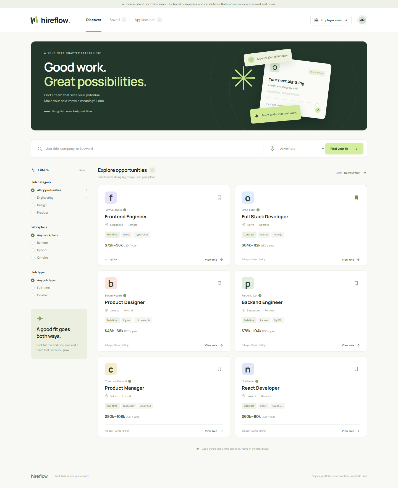
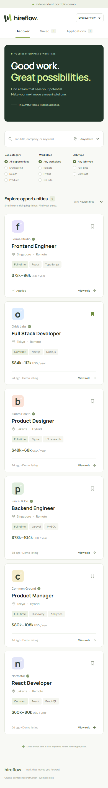

# Hireflow — job marketplace reconstruction

An **independent, original portfolio reconstruction** of the functional domain of a recruitment marketplace. The application is branded Hireflow and uses fictional companies, roles, and candidates throughout.

## Provenance and dates

- **Resume-reported context:** Glints, Full-Stack Software Engineer, **January 2022–July 2023**. The supplied resume describes a job marketplace, React/TypeScript UI, Node.js APIs, relational/document databases, and testing.
- **This repository:** a newly written demonstration of selected domain workflows. It is **not official Glints source code**, a recovered historical repository, or evidence that any particular person delivered these features at Glints.
- The resume period is contextual documentation, **not this code's creation date**. Development and Git history must retain their actual current timestamps. No commits or contributions are backdated.
- No company code, credentials, customer data, logos, or confidential designs were used. Hireflow's interface and implementation are original.

Public context: Glints' [August 2022 product announcement](https://glints.com/sg/inside/glints-raises-usd50m-funding/) identifies its JobSearch business, and its [February 2022 engineering interview](https://tech.glints.com/fireside-chat-from-bootcamp-to-glints/) describes a Marketplace team. These establish the company/domain context, not the resume subject's involvement in any particular feature. The demo does not reproduce the Glints interface.

## Features

- Search roles by title, company, or skill; filter by category, location, workplace, and job type; sort by recency or compensation.
- Save/unsave roles with persistent, idempotent shortlisting.
- Inspect role details and submit a validated application. The database enforces one application per demo candidate per role, even if the email changes.
- Track applications and withdraw an active application.
- Switch to a shared employer workspace, filter by role, review introductions, and progress candidates through a guarded pipeline: `Submitted → Reviewing → Interview → Offer → Hired`. Declining is allowed at each active stage; closed applications remain closed.
- Durable SQLite storage and synthetic sample pipeline entries. No paid APIs or external application services.

For a repeatable review, follow the [application walkthrough](docs/walkthrough.md), including discovery, persistent saves, hiring, withdrawal, and API failure cases.

## Screenshots

Desktop and mobile views captured from the working application with synthetic demo data.



<details>
<summary>Mobile view</summary>



</details>

## Run locally

Requires **Node.js 24+** and npm. Node's built-in `node:sqlite` avoids a native third-party database dependency; Node may print an experimental SQLite warning.

```sh
npm ci
npm run dev
```

Open `http://127.0.0.1:3000`. To use another port: `npm run dev -- --port 3100`.

The database is automatically created and seeded at `.data/hireflow.sqlite`. To change its location, copy `.env.example` to `.env.local` and set `HIREFLOW_DB_PATH`. Existing data is preserved on restart. To reset, stop the server and remove **only this project's `.data` directory**; the next startup recreates the synthetic dataset.

```sh
npm test
npm run typecheck
npm run lint
npm run build
npm start
```

## Architecture

- Next.js App Router and React/TypeScript provide a responsive client interface.
- Node runtime route handlers validate requests and return structured HTTP errors.
- `lib/store.ts` owns SQLite schema, seed initialization, duplicate protection, and allowed status transitions. SQL statements use bound parameters; updates check the previous stage to reject conflicting changes.
- `lib/seed.ts` contains only synthetic jobs. Sample candidates use reserved `example.com` email addresses.
- `tests/store.test.ts` exercises real SQLite writes, database reopening, duplicate applications, idempotent saves, input validation, withdrawal ownership, terminal stages, and permitted transitions.
- `.github/workflows/ci.yml` runs lint, type checking, tests, and a production build on Node 24.

Browser verification additionally exercised live search, saved-job persistence after reload, application submission, employer review, candidate withdrawal, mobile layouts, and keyboard dismissal of native dialogs in an isolated headless Chrome context. Screenshots document the rendered interface, not historical employer work.

| Endpoint | Purpose |
| --- | --- |
| `GET /api/workspace` | Read synthetic jobs, the shared shortlist, and applications |
| `PUT /api/saved` | Set `{ jobId, saved }` for the demo candidate |
| `POST /api/applications` | Submit `{ jobId, name, email, note }` |
| `PATCH /api/applications/:id` | Move `{ status, actor }` through the demo workflow |

## Demo boundaries

**No authentication or private accounts are implemented.** There is one shared demo candidate and an open employer preview. Role switching and the `actor` request field demonstrate workflow behavior; they are **not authorization controls**. Anyone with access to a running instance can view and change its sample data. Use fictional details only.

Applications stay in the local SQLite file; no email, real recruiter contact, CV upload, or external job submission occurs. Compensation and recency values are fictional presentation data, not current vacancies. The app is designed for a single local Node process and a persistent local filesystem, not ephemeral/serverless deployment. Production use would need authenticated sessions, server-enforced organization membership, private-data access rules, rate limiting, audit history, database migrations/backups, and an appropriate hosted database. Google Fonts are optional external styling requests; system fonts provide a fallback.

## License

MIT. See [LICENSE](LICENSE).
