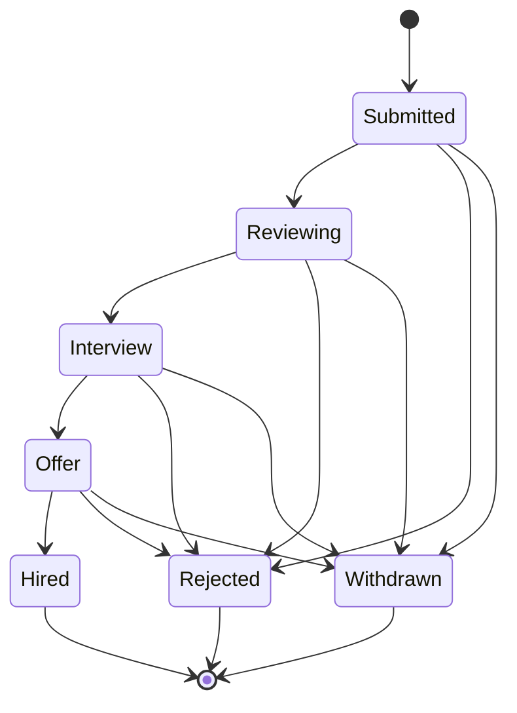

# Hireflow review walkthrough

This guide describes the current, independent reconstruction. The resume-reported work period is January 2022–July 2023; the application and this guide were newly authored in November 2026. The original account and historical commits have not been recovered. The steps below demonstrate this repository's behavior using fictional data.

## Prepare a repeatable review

Follow [the local setup](../README.md#run-locally) with Node.js 24 or later. A new database contains six fictional roles, five sample applications, and no applications from the shared demo candidate.

If you already used the app, set `HIREFLOW_DB_PATH` in `.env.local` to a separate database file, such as `.data/reviewer.sqlite`, before starting it. Restart the server after changing the path: the store is initialized once per process. Use a previously unused file for a fresh dataset. Existing data is preserved when the server restarts.

All visitors share the same demo candidate and employer workspace. Enter fictional details only. No email or application is sent to an outside company.

## Discover and save a role

1. Open **Discover**. Select **Tokyo**, **Remote**, and **Contract**.
2. Confirm that **Full Stack Developer at Orbit Labs** is the single result. Its stable seed ID is `j-02`.
3. Open the role and inspect its description, responsibilities, and requirements.
4. Save it, close the dialog, and open **Saved**.
5. Reload the page and reopen **Saved**. The role remains saved because the shortlist is stored in SQLite.
6. Unsave the role. It disappears from the shortlist and remains unsaved after another reload.

Saving the same role repeatedly does not create duplicate shortlist entries. **Reset** clears discovery filters; it does not delete saved roles or applications.

## Complete a hiring workflow

1. Return to **Discover**, find Orbit Labs again, and choose **Apply for this role**.
2. Enter `Alex Morgan`, `alex@example.com`, and this introduction:

   > I enjoy building accessible interfaces and reliable APIs with a thoughtful team.

3. Choose **Send demo application**. Open **Applications** and confirm the new status is **Submitted**.
4. Reload and confirm the application persists.
5. Switch to **Employer view**. Under **Filter pipeline by role**, choose the Orbit Labs role and open Alex's card.
6. Advance one stage at a time: **Reviewing**, **Interview**, **Offer**, then **Hired**. Reopen the card for each next action.
7. Confirm that the application moves to **Closed applications**. Its detail view has no further stage actions.
8. Return to **Candidate view** and confirm the same final status appears under **Applications**.

Employers may decline an application at any active stage. Only the shared candidate may withdraw that candidate's own active application. These are domain workflow rules; the demo has no authenticated users or organization access controls.

## Check withdrawal separately

Use **React Developer at Northstar** (`j-06`) so the hiring scenario remains intact.

1. Submit a second application with fictional details.
2. Open it from **Applications** and choose **Withdraw application**.
3. Reload and confirm **Withdrawn** is preserved in both candidate and employer views.
4. Inspect the role again. It remains marked as already applied.

The unique candidate/role constraint remains in force after withdrawal or rejection. Changing the email does not permit a second application to the same role. Reapplication and reopening closed applications are outside this demo's workflow.

## Inspect the API contract

`GET /api/workspace` returns all fictional jobs, the shared shortlist, and all synthetic applications. It is useful for identifying the application ID returned after submission. This endpoint provides no private account boundary.

The following JSON bodies show valid mutations. Send requests only to a local demo instance and use `Content-Type: application/json`.

| Method and path | JSON body | Expected result |
| --- | --- | --- |
| `PUT /api/saved` | `{"jobId":"j-02","saved":true}` | `200`; the shared shortlist includes `j-02` |
| `POST /api/applications` | `{"jobId":"j-02","name":"Alex Morgan","email":"alex@example.com","note":"I enjoy building accessible interfaces and reliable APIs with a thoughtful team."}` | `201` for a role not previously applied to by the demo candidate |
| `PATCH /api/applications/<id>` | `{"status":"Reviewing","actor":"employer"}` | `200` when the selected application is currently `Submitted` |
| `PATCH /api/applications/<id>` | `{"status":"Withdrawn","actor":"candidate"}` | `200` for the demo candidate's own active application |

These examples are alternatives to the browser steps, not additional applications to submit after completing them. Use the ID returned by the API in place of `<id>`.

Failures return a JSON object with an `error` message:

| Case | HTTP status | Example response or behavior |
| --- | --- | --- |
| Malformed JSON | `400` | `{"error":"Request body must be valid JSON."}` |
| Name outside 2–80 characters, invalid email, or introduction outside 30–2,000 characters | `400` | A field-specific validation message |
| Valid application fields with an unknown role ID | `404` | `{"error":"This role could not be found."}` |
| Duplicate application, including with another email or after withdrawal | `409` | `{"error":"You have already applied for this role."}` |
| Candidate attempts an employer action or withdraws a sample candidate's application | `403` | The domain action is rejected |
| Attempt to skip a stage or reopen a closed application | `409` | The transition is rejected |

The `actor` field selects demo workflow behavior. A caller can choose it freely; it is not proof of identity or authorization.

## Follow the implementation

| Concern | Source |
| --- | --- |
| Search, combined filters, sorting, dialogs, and workspace switching | [`app/page.tsx`](../app/page.tsx) |
| Six fictional job fixtures | [`lib/seed.ts`](../lib/seed.ts) |
| SQLite initialization, one-time sample seeding, uniqueness, and guarded stage updates | [`lib/store.ts`](../lib/store.ts) |
| Structured error responses | [`lib/http.ts`](../lib/http.ts) |
| HTTP handlers | [`app/api`](../app/api) |
| Persistence and domain regression checks | [`tests/store.test.ts`](../tests/store.test.ts) |

The existing domain tests can be run with `npm test`. They use temporary or in-memory databases, separate from the running demo. Search and filter behavior is implemented in the client interface; it is not a server-side search service.

Production use would require authentication, server-enforced access rules, private-data handling, operational limits, and database deployment planning. See [the demo boundaries](../README.md#demo-boundaries) before exposing a running instance.
